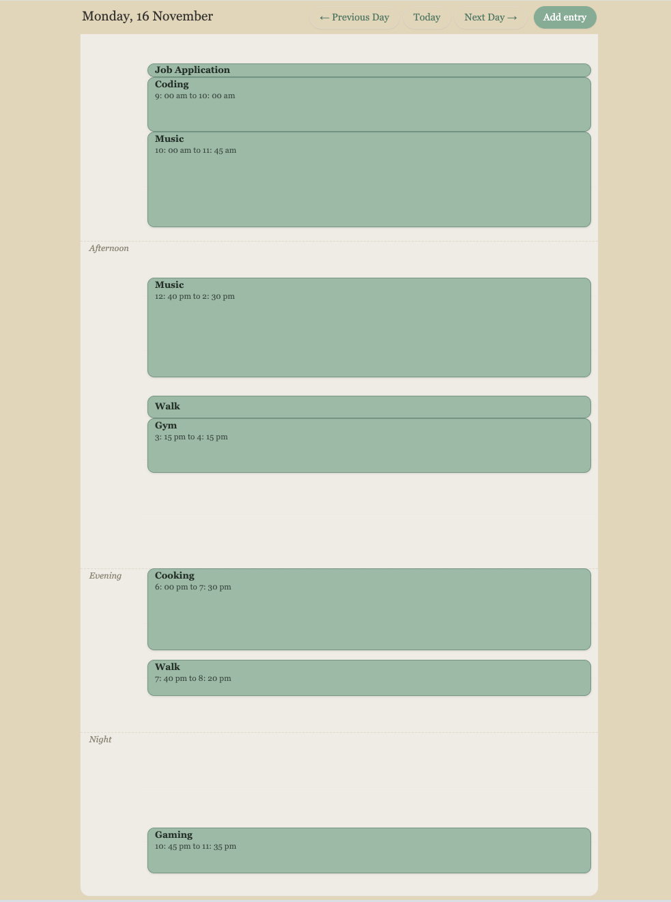
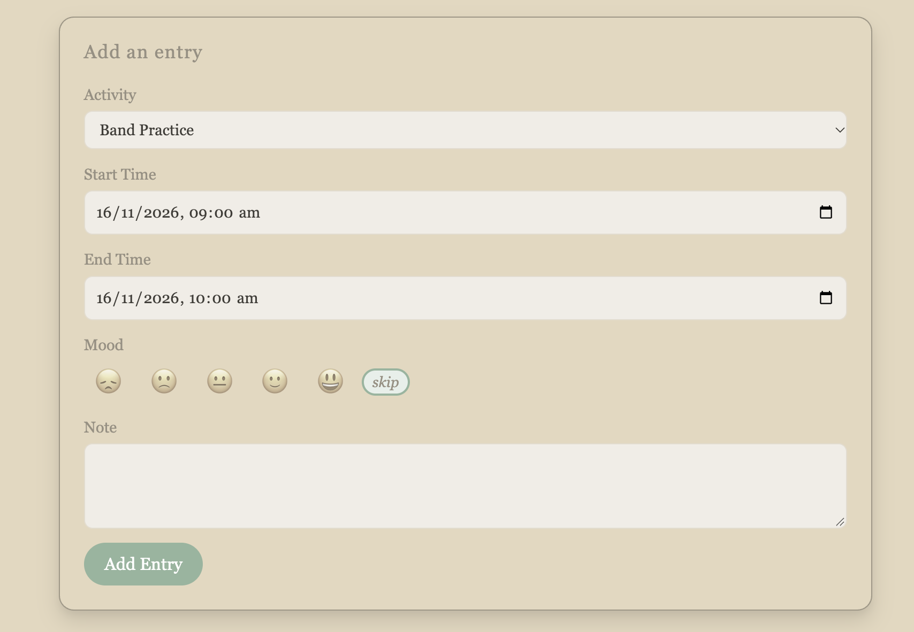
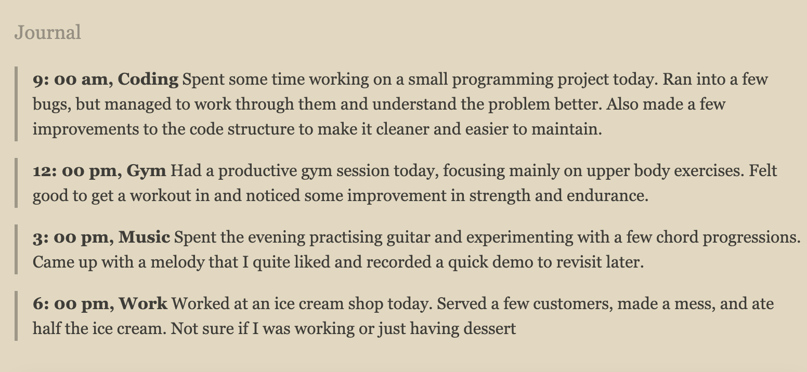

# Reflections

A calm, relaxed daily activity tracker. Instead of measuring productivity, Reflections helps you look back on how you spent your days.

**Status:** MVP Completed – 18 November 2026


## Why I built it

As days turn into weeks and months, people can lose awareness of how they have spent their time and the experiences that have shaped their lives. I built this project to help people become more aware of how they use their time.

## Features

- A 24-hour vertical timeline with soft time-of-day labels (Midnight, Morning, Afternoon, Evening, Night)
- Add, edit and delete activity entries, with start and end times
- Overlapping entries sit side by side so none are hidden
- Pick an existing activity or create a new one
- Optional mood (five faces) and optional notes
- Browse previous and next days, or jump back to today
- A "now" line on today's timeline, and the view scrolls to a useful spot
- Friendly validation messages and a gentle save confirmation
- A journal mode that automatically displays below the timeline

## Screenshots

### Daily Timeline



### Form



### Journal



## Built with

Python, Flask, SQLite, HTML, CSS and a little JavaScript.

## Running it locally

1. Clone the repository and open the folder in a terminal.
2. Create and activate a virtual environment:

   ```
   python -m venv .venv
   source .venv/bin/activate
   ```
3. Install the dependencies:

   ```
   pip install -r requirements.txt
   ```
4. Create the database (this also adds a default "General" category):

   ```
   python -c "import db; db.init_db()"
   ```
5. Start the app:

   ```
   python main.py
   ```

   The application runs locally with Flask debug mode enabled.
6. Open http://127.0.0.1:5001 in your browser.

## Project structure

```
main.py          Flask routes
db.py            Database functions
schema.sql       Table definitions
templates/       HTML pages
static/          CSS
Docs/            Project overview and requirements
```

## Known limitations

- Time inputs must be entered manually in Safari, which can be inconvenient.
- The application has no login functionality and is designed for a single user, with data stored locally in an SQLite database.
- There is currently no data export or backup functionality, so recorded activities may be lost if the local database is lost.

## Planned for future versions

- Customisation options, including different colour themes and colours for individual activities.
- User accounts and login functionality.
- Enhanced daily and weekly summaries, with insights into frequently performed activities.
- Calendar navigation to select specific dates and revisit past activities.
- AI integration to provide more meaningful insights and personalised summaries.

## What I learned

University taught me about the ineividual components of software engineering, but building this project taught me how to bring those components together.

One of the most valuable parts of this project was the planning phase. I spent over three days working on system design, gathering requirements, writing user stories and creating ER diagrams. This helped me establish a clear direction before development and made the implementation process much smoother.

One thing I would improve next time is relying less on AI-generated code and spending more time independently solving implementation problems. I want to strengthen my ability to write, understand and debug code independently.
